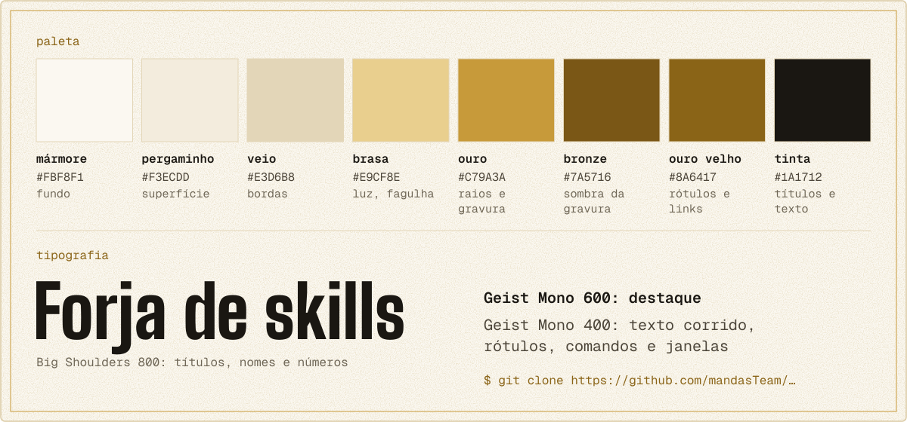
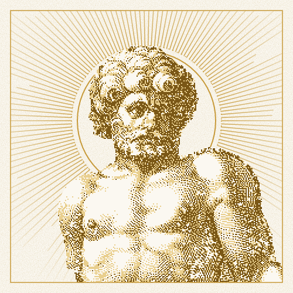

# Direção de arte do mandasTeam

<p align="center">
  
</p>

Este documento define a identidade visual do mandasTeam: o perfil da organização, os banners
e cards dos repositórios de skill e qualquer peça nova. Os tokens daqui são a fonte única.
O gerador `tools/build_assets.py` aplica tudo isso; mudar a identidade é mudar os dois juntos.

## 1. Princípio

**Uma oficina de gravura clássica que imprime em ouro sobre mármore.** O time forja ferramentas
para agentes, então o patrono é **Hefesto**, o ferreiro dos deuses. A linguagem vem do site do
[Hermes Agent](https://hermes-agent.nousresearch.com/): estatuária clássica com dithering, raios
de linha fina saindo da figura, janelas de terminal flutuando sobre ela, título em gótica
condensada enorme e texto em monoespaçada. O que muda é a luz: em vez de azul elétrico, ouro
sobre papel claro.

Parece: folha de catálogo de museu, prancha de gravura, ferramenta de terminal bem cuidada.
Não parece: landing page de startup, gradiente dourado de "premium", tema escuro com neon.

## 2. Paleta

<p align="center">
  
</p>

| Token | Hex | Papel | Contraste sobre mármore |
|---|---|---|---|
| mármore | `#FBF8F1` | fundo de toda peça | — |
| pergaminho | `#F3ECDD` | superfície secundária: pranchas, janelas, plinto | — |
| veio | `#E3D6B8` | bordas | decorativo |
| brasa | `#E9CF8E` | luz da estátua; texto sobre tinta | só sobre tinta |
| ouro | `#C79A3A` | raios, auréola, filetes, meio-tom da estátua | 2,4:1, **nunca texto** |
| bronze | `#7A5716` | sombra da estátua | 6,2:1 |
| ouro velho | `#8A6417` | rótulos, links, destaque em texto | 5,1:1 |
| tinta | `#1A1712` | títulos, texto principal, barra das janelas | 16,9:1 |
| grafite | `#4B4438` | texto corrido | 9,1:1 |
| pó | `#6E6656` | texto de apoio | 5,4:1 |

Regras:

- Branco e ouro dominam; tinta só em texto, barra de janela e caixa de comando.
- Ouro vivo é linha, ponto e textura. Em texto, só o `ouro velho`, que passa de 4,5:1.
- Nada de gradiente dourado nem brilho metálico. O ouro é tinta chapada, como impressão.
- O fundo mármore leva um grão de papel quase invisível (`feTurbulence`, cerca de 5% de opacidade).

## 3. Tipografia

| Papel | Fonte | Peso | Tamanho na origem (1200 px) |
|---|---|---|---|
| Nome do time, títulos de seção, nome de skill, numeral de prancha | Big Shoulders (opsz 72) | 800 | 24–200 |
| Texto corrido, rótulos, comandos | Geist Mono | 400 | 15–19 |
| Destaque em texto, linha principal, comandos em janela | Geist Mono | 600 | 15–26 |

As duas são OFL e ficam em `tools/fonts/` com as licenças. Elas substituem as fontes do site do
Hermes (Rules Gothic Compressed e Aeonik Fono), que são proprietárias.

- O nome é `mandasTeam` em camelCase, quebrado em duas linhas (`mandas` / `Team`) no tamanho máximo.
- Rótulo pequeno em mono, com cara de caminho (`mandasTeam / oficina de skills`, `~/.claude/skills`).
- Caixa-alta espaçada só na **inscrição do plinto** (`HEFESTO`), como letra gravada em pedra.
- Nada abaixo de 15 px na origem: o GitHub exibe 1200 px em cerca de 830 px.

## 4. Composição: um card só

O perfil é **uma folha única** de 1200 × 1400 px, sem `##` nem imagem solta no markdown.
A ordem, de cima para baixo:

1. **Cabeçalho:** `mandasTeam / oficina de skills` à esquerda, `github.com/mandasTeam` à direita,
   filete de ouro embaixo.
2. **Herói:** o nome gigante à esquerda; à direita, Hefesto sobre o plinto, com a auréola e os
   raios saindo da cabeça. Abaixo do nome: a linha principal, a apresentação e o "como usar".
3. **Skills:** título com régua e fagulha, e uma **prancha** por skill, lado a lado.

Formas:

- **Placa:** mármore, borda veio de 2 px, raio de 6 px e filete de ouro de 1 px a 14 px da borda
  (a marca da chapa). É a moldura da folha inteira.
- **Prancha de skill:** pergaminho com borda veio, numerada como lâmina de álbum (`Pl. I`, `Pl. II`),
  nome em display, descrição em mono e o `git clone` numa caixa de tinta.
- Janelas, pranchas e caixas têm canto reto. As únicas curvas da identidade são a auréola e o grão.
- Margem lateral de 72 px. Texto alinhado à esquerda.

Com várias imagens empilhadas o GitHub abre vãos entre elas, por isso o card é um só. O custo é
que uma `` tem um link no máximo: os repositórios ficam acessíveis pela lista de repos que o
GitHub mostra logo abaixo do README da organização.

## 5. Motivos

**A fagulha** é o motivo que se repete: raios finos em ouro saindo de um ponto, com comprimentos
variando em feixes.

| Onde | Como aparece |
|---|---|
| Herói | sol da forja: 180 raios saindo da cabeça de Hefesto, sumindo nas bordas (máscara radial), com auréola dupla |
| Título de seção | régua de ouro terminando numa fagulha pequena |
| Prancha de skill | um quarto de fagulha no canto superior direito |
| Martelo | fagulhas quadradas, do tamanho do ponto do dithering, que piscam |

**O plinto:** base em pergaminho com filete de ouro e a inscrição `HEFESTO`. Assenta a estátua e
fecha o herói.

**A janela:** pergaminho com barra em tinta, sombra chapada em ouro deslocada 6 px, título em brasa,
comando em ouro velho e saída em tinta. Uma janela por peça, flutuando sobre a estátua.

## 6. Imagem

- Figura: o Vulcano/Hefesto de Hendrick Goltzius (c. 1592), domínio público, **recortada do nicho**
  (segmentação com SAM + ajuste à mão) e salva em `tools/art/vulcan.png` (cinza + alfa).
- Tratamento: dithering Floyd–Steinberg em **quatro tons** (transparente, brasa, ouro, bronze),
  ponto de 1 px. Fora da silhueta é transparente: a estátua fica solta sobre o mármore.
  A função `dither()` faz tudo; não trate imagem fora do script.
- Nova figura só se for gravura ou estátua clássica de domínio público, ligada a Hefesto ou à forja.
  Foto, ilustração moderna, 3D ou arte gerada ficam de fora.
- Uma figura por peça.

### Avatar da organização



- `assets/avatar.png`, 500 × 500, gerado junto com o resto (`avatar()` no `build_assets.py`).
- Busto (cabeça e peito) com o sol da forja: auréola dupla e raios saindo da cabeça, dentro da placa
  com filete de ouro. O busto sangra pela base da chapa.
- Sem texto: no GitHub o avatar aparece com 20 a 40 px e o nome já vem escrito ao lado.
- Ponto do dithering de 2 px, não 1: com 1 px o rosto vira borrão quando o GitHub reduz a imagem.
- Estático. PNG não anima, então não há fagulhas.
- A API não troca avatar de organização: suba o PNG em
  `github.com/organizations/mandasTeam/settings/profile` → **Profile picture** → **Upload a photo**.

## 7. Movimento

- Um gesto só: as fagulhas do martelo piscam em tempos diferentes (ciclo de 2,6 s).
- Todo o resto fica parado. Nada cruza a tela.
- Com `prefers-reduced-motion`, a animação para e as fagulhas ficam acesas.

## 8. Texto

- Frase normal, verbo simples, em português. Nome de skill, comando e arquivo ficam como são
  (`SKILL.md`, `readme-designer`).
- Descrição de skill em uma frase: o que ela entrega, sem adjetivo.
- Sem trocadilho de forja ou mitologia no texto. O tema está na imagem; a copy fica sóbria.
- O `alt` do card e o `<title>` do SVG têm o texto inteiro. Com `--profile`, o script gera o
  `profile/README.md` do repo `.github` com o `alt` copiado do `<title>`, então os dois nunca divergem.

## 9. Faça e não faça

| Faça | Não faça |
|---|---|
| Uma folha única com placa, grão e filete de ouro | Pilha de cards com `##` e tabelas entre eles |
| Ouro como linha, ponto e textura | Ouro em texto pequeno, gradiente ou brilho metálico |
| Estátua clássica recortada, em dithering de 4 tons | Foto, ícone genérico, emoji, arte gerada |
| Raios grandes só no herói, fagulha pequena no resto | Raios em todo canto competindo com o texto |
| Rótulo mono com cara de caminho | Rótulo em CAIXA-ALTA espaçada (exceto a inscrição do plinto) |
| Fagulhas piscando, e só elas | Objeto atravessando a tela, várias animações |
| Texto em path pelo gerador, com glifos reaproveitados | `<text>` com fonte do sistema ou SVG editado à mão |

## 10. Como gerar

```bash
python -m pip install -r tools/requirements.txt
python tools/build_assets.py                                   # escreve assets/*.svg e avatar.png
python tools/build_assets.py --profile ../mandasTeam-.github   # e o profile/README.md do repo .github
```

O perfil da organização mora em `mandasTeam/.github`, que guarda **só** o `profile/README.md`.
A imagem vem daqui, pela URL absoluta
`https://github.com/mandasTeam/team-docs/raw/main/assets/mandasteam.svg`. Mudou o card? Rode o
build, faça push aqui; só precisa commitar no `.github` se o texto (e portanto o `alt`) mudou.

O texto vira path (HarfBuzz + fontTools) porque o GitHub não carrega fonte dentro de ``.
Cada glifo é desenhado uma vez em `<defs>` e repetido com `<use>`; a estátua entra em base64.
Assim a folha inteira fica em cerca de 110 KB (o limite é 250 KB).

Para um repo de skill novo, copie `tools/` deste repo e reaproveite `plate()`, `rays()`,
`skill_plate()` e `Glyphs` para o banner dele, com estes mesmos tokens.

Exemplo pronto: o README de [`readme-designer`](https://github.com/mandasTeam/readme-designer)
(`tools/build_banner.py` de lá). É uma folha única no mesmo herói (nome em duas linhas, Hefesto no
plinto, janela), com o fluxo da skill em lâminas `Pl. I`–`Pl. VI`, instalação em caixas de tinta e
a árvore de arquivos numa prancha. O README é só a folha: nada de `<details>`, selo ou rodapé em
markdown embaixo dela. O `alt` sai do `<title>` com `--readme`.

### Checklist antes de publicar

- [ ] Build sem `MissingGlyph` e todo SVG abaixo de 250 KB.
- [ ] Conferido renderizado sobre fundo branco e sobre `#0d1117`.
- [ ] Nenhum texto em `ouro` vivo; contraste de texto ≥ 4,5:1.
- [ ] `alt` com o texto inteiro em cada imagem.
- [ ] Uma animação só, com `prefers-reduced-motion`.
